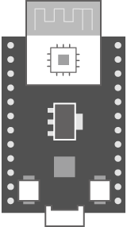

# Wattanaroj Butdee

### Data Science & Software Innovation Student

I am a fourth-year student at Ubon Ratchathani University, building **FallHelp** — a wearable IoT system for fall detection and caregiver alerts.

English | [ภาษาไทย](README.th.md)

  
  

## Featured Projects

### FallHelp — Senior Project

FallHelp is my senior project for safer, faster caregiver response. It connects a neck-worn ESP32 device with a caregiver mobile application through a real-time backend.

- Wearable fall detection using accelerometer and gyroscope data
- Heart-rate capture when a possible fall is detected
- MQTT and Socket.IO event flows for alerts and acknowledgement
- React Native and Expo mobile experience for caregivers
- Backend API, PostgreSQL, push notifications, and admin operations

→ [View the FallHelp repository](https://github.com/Wattanaroj2567/fallhelp)

### Media Loader — Personal Project

Media Loader is an independent side project for analyzing supported media URLs and managing authorized media-processing jobs through a web application. It is a personal project, separate from my coursework.

→ [View the Media Loader repository](https://github.com/Wattanaroj2567/media-loader)

## Tech Stack

<table>
  <tr>
    <td><strong>Languages</strong></td>
    <td>
      
    </td>
  </tr>
  <tr>
    <td><strong>Server &amp; data</strong></td>
    <td>
      
    </td>
  </tr>
  <tr>
    <td><strong>Client &amp; mobile</strong></td>
    <td>
      &nbsp;
      
    </td>
  </tr>
  <tr>
    <td><strong>Embedded &amp; IoT</strong></td>
    <td>
      &nbsp;
      &nbsp;
      &nbsp;
      &nbsp;
      
    </td>
  </tr>
  <tr>
    <td><strong>Tools</strong></td>
    <td>
      
    </td>
  </tr>
  <tr>
    <td><strong>AI Coding</strong></td>
    <td>
      &nbsp;
      &nbsp;
      
    </td>
  </tr>
</table>
