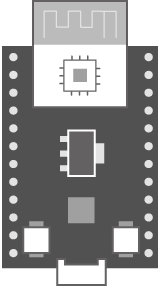

# Wattanaroj Butdee

### นักศึกษาสาขาวิทยาการข้อมูลและนวัตกรรมซอฟต์แวร์

ผมเป็นนักศึกษาชั้นปีที่ 4 มหาวิทยาลัยอุบลราชธานี กำลังพัฒนา **FallHelp** — ระบบ IoT แบบสวมใส่สำหรับตรวจจับการล้มและแจ้งเตือนผู้ดูแล

[English](README.md) | ภาษาไทย

  
  

## โปรเจกต์เด่น

### FallHelp — โปรเจกต์จบ

FallHelp เป็นโปรเจกต์จบที่มุ่งช่วยให้ผู้ดูแลตอบสนองได้รวดเร็วและปลอดภัยขึ้น โดยเชื่อมต่ออุปกรณ์ ESP32 แบบสวมใส่บริเวณคอกับแอปมือถือสำหรับผู้ดูแลผ่าน backend แบบ real-time

- ตรวจจับการล้มจากข้อมูล accelerometer และ gyroscope บนอุปกรณ์สวมใส่
- เก็บข้อมูลอัตราการเต้นของหัวใจเมื่อตรวจพบความเสี่ยงว่าจะล้ม
- ใช้ MQTT และ Socket.IO สำหรับส่งการแจ้งเตือนและรับการยืนยัน
- แอป React Native และ Expo สำหรับผู้ดูแล
- Backend API, PostgreSQL, push notifications และระบบจัดการหลังบ้าน

→ [ดู repository ของ FallHelp](https://github.com/Wattanaroj2567/fallhelp)

### Media Loader — โปรเจกต์ส่วนตัว

Media Loader เป็นโปรเจกต์ส่วนตัวที่ทำแยกจากรายวิชา ใช้วิเคราะห์ URL ของสื่อที่รองรับและจัดการงานประมวลผลสื่อที่ได้รับอนุญาตผ่านเว็บแอป

→ [ดู repository ของ Media Loader](https://github.com/Wattanaroj2567/media-loader)

## เทคโนโลยีที่ใช้

<table>
  <tr>
    <td><strong>ภาษา</strong></td>
    <td>
      
    </td>
  </tr>
  <tr>
    <td><strong>Backend และข้อมูล</strong></td>
    <td>
      
    </td>
  </tr>
  <tr>
    <td><strong>Client และ Mobile</strong></td>
    <td>
      &nbsp;
      
    </td>
  </tr>
  <tr>
    <td><strong>Embedded และ IoT</strong></td>
    <td>
      &nbsp;
      &nbsp;
      &nbsp;
      &nbsp;
      
    </td>
  </tr>
  <tr>
    <td><strong>เครื่องมือ</strong></td>
    <td>
      
    </td>
  </tr>
  <tr>
    <td><strong>เครื่องมือช่วยเขียนโค้ดด้วย AI</strong></td>
    <td>
      &nbsp;
      &nbsp;
      
    </td>
  </tr>
</table>
